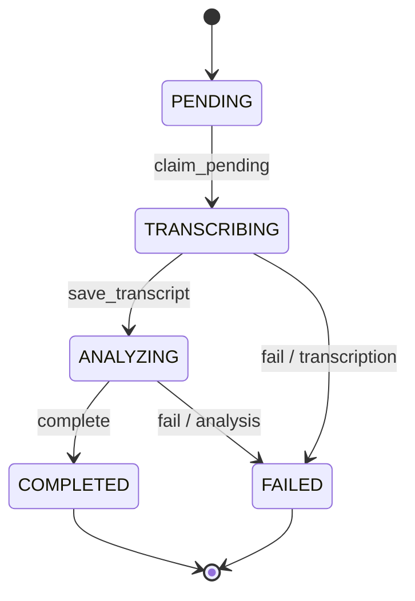
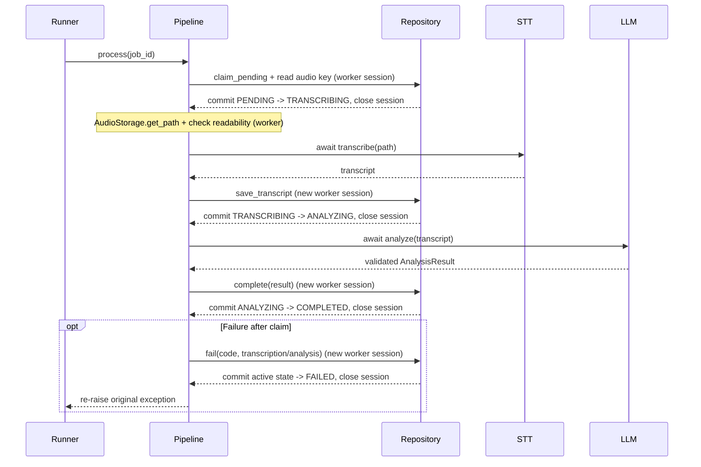
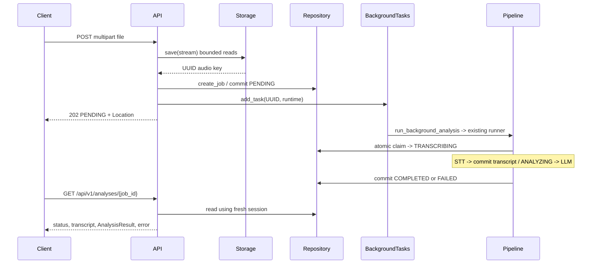

# Conversation Analyzer

MVP backend для записи и AI-анализа разговоров. Архитектура - модульный монолит FastAPI; STT-провайдеры и LLM Analyzer изолированы от HTTP и приложения.

Стек: Python 3.12+, uv, FastAPI, Uvicorn, pydantic-settings, OpenAI SDK, SQLAlchemy 2.x и SQLite; pytest, HTTPX и Ruff для разработки.

## Установка

В облачном окружении Debian 13/Bash Python и uv уже доступны. Используется одна `.venv`; активация не нужна.

```bash
uv sync --locked --dev
# Необязательно: локальные настройки (не перезаписывайте существующий .env)
cp -n .env.example .env
```

На другой машине нужны Python 3.12+ и uv. Если Python отсутствует: `uv python install 3.12`.
`uv.toml` хранит кэш в `.cache/uv`, доступном для записи в cloud sandbox.
Настройки `APP_NAME`, `APP_ENV`, `DEBUG`, `LOG_LEVEL` читаются из окружения и `.env`; окружение имеет приоритет. Настройки кэшируются до перезапуска процесса.

## Запуск

```bash
uv run python scripts/init_db.py
uv run uvicorn app.main:app --host 127.0.0.1 --port 8000 --reload
```

Откройте UI: [http://127.0.0.1:8000/](http://127.0.0.1:8000/). Health: `curl -fsS http://127.0.0.1:8000/health` -> `{"status":"ok"}`.

### Frontend

Статика лежит в `static/` и отдается самим FastAPI (`GET /`, `/static/...`).

1. Нажмите **Начать запись**, разрешите микрофон, говорите, затем **Остановить** - файл уйдет на анализ сам.
2. Либо перетащите/выберите готовый файл (WAV, MP3, WEBM, M4A, до лимита `MAX_AUDIO_SIZE_MB`) и нажмите **Отправить на анализ**.
3. Дождитесь статусов `PENDING` -> `TRANSCRIBING` -> `ANALYZING` -> результата: summary, strengths, mistakes, recommendations и транскрипции.

Ограничения браузера: микрофон работает на `localhost` или по HTTPS; нужен `MediaRecorder`. Формат записи должен совпадать с API (обычно WEBM/M4A). Внешних CDN и frontend-зависимостей нет.

### Docker

Нужны Docker и Compose, плюс локальный `.env` (см. `.env.example`). SQLite и аудио пишутся в volume `app-data`, веса Whisper - в `hf-cache`.

```bash
cp -n .env.example .env
docker compose up --build
```

Сервис слушает `http://127.0.0.1:8000` (порт через `PORT`). Entrypoint один раз инициализирует БД и запускает Uvicorn. Остановка: `docker compose down`.

## Проверки

```bash
uv run pytest
uv run ruff check .
uv run ruff format --check .
```

Форматирование: `uv run ruff format .`. Новые зависимости: `uv add <package>` или `uv add --dev <package>`.

## Структура и статус

```text
app/
  main.py          # create_app() и ASGI app
  api/health.py    # GET /health
  api/analyses.py  # POST /api/v1/analyses и GET /api/v1/analyses/{job_id}
  api/schemas.py   # типизированные ответы с существующим AnalysisResult
  core/config.py  # настройки и get_settings()
  core/logging.py # стандартное логирование
  core/dependencies.py # зависимости HTTP из lifespan приложения
  transcription/  # контракт, локальный и облачный STT, фабрика
  analysis/       # LLM Analyzer, модели, промпт и проверка цитат
  persistence/    # Engine, Session Factory, AnalysisJob и Repository
  storage/local.py # потоковое локальное хранение аудио
  application/create_job.py # создание задачи с компенсацией ошибок БД
  application/pipeline.py # обработка задачи: STT, транскрипт, LLM, результат
  application/runner.py # переиспользуемые ресурсы и BackgroundTasks callback
scripts/transcribe.py # проверка STT из командной строки
scripts/analyze.py    # анализ готовой транскрипции
scripts/init_db.py    # явная инициализация SQLite
scripts/process_job.py # обработка существующей задачи по UUID
static/            # UI: index.html, styles.css, app.js, api.js, recorder.js
tests/             # изолированные тесты приложения и настроек
AGENTS.md          # рабочие инструкции для следующих агентов
```

Этап 1: окружение, application factory, настройки, логирование, healthcheck и тесты.
Этап 2: локальная и облачная транскрибация через единый асинхронный контракт.
Этап 3: независимый LLM-анализ готовой транскрипции.
Этап 4: SQLite, локальное хранение аудио и защищенный жизненный цикл задач.
Этап 5: ProcessingPipeline, запуск существующей задачи по UUID и callback для BackgroundTasks.
Этап 6: REST API загрузки аудио, фоновый запуск и получение статуса/результатов. Frontend пока отсутствует.


## Транскрибация

По умолчанию используется `STT_PROVIDER=local`: faster-whisper загружает `small` при первом вызове, на CPU с `int8` и четырьмя потоками; язык - русский. Настройки `WHISPER_MODEL`, `WHISPER_DEVICE`, `WHISPER_COMPUTE_TYPE`, `WHISPER_LANGUAGE`, `WHISPER_CPU_THREADS` описаны в `.env.example`. `WHISPER_MODEL` может содержать путь к локальной директории модели в формате CTranslate2. Один экземпляр провайдера повторно использует модель и выполняет одно распознавание за раз. На CPU загрузка и распознавание могут занять заметное время и оперативную память.

```bash
uv run python scripts/transcribe.py path/to/audio.wav
```

При первом использовании имени модели faster-whisper скачивает веса в системный кэш Hugging Face (обычно `~/.cache/huggingface/hub` в Linux или каталог кэша пользователя в Windows; расположение зависит от `HF_HOME` и `HF_HUB_CACHE`). В репозиторий веса не сохраняются. Для offline-работы заранее выполните локальную транскрибацию с нужной моделью при доступном интернете, либо заранее подготовьте директорию модели CTranslate2 и укажите ее в `WHISPER_MODEL`. На целевой машине модель и все файлы должны быть доступны до отключения сети.

Для облачного режима задайте `STT_PROVIDER=cloud` и `OPENAI_API_KEY` в окружении или локальном `.env`. `OPENAI_BASE_URL` задает базовый URL API (по умолчанию официальный OpenAI; подходит для совместимых прокси). `OPENAI_STT_MODEL` выбирает модель (по умолчанию `gpt-4o-mini-transcribe`), `OPENAI_STT_TIMEOUT` - таймаут в секундах. Облачные запросы требуют сети и могут быть платными. Локальному режиму ключ не нужен.

В коде создайте провайдер через `create_transcriber(settings)` и повторно используйте его. У облачного провайдера после завершения работы вызовите `await provider.aclose()`. Оба провайдера возвращают строку; pipeline использует этот же контракт.

## Анализ готовой транскрипции

`app.analysis` принимает готовую строку и возвращает Pydantic `AnalysisResult`: `summary`, `strengths`, `mistakes`, `recommendations`. Каждый элемент `strengths` и `mistakes` содержит `description` и дословную `quote` либо `null`. Используются OpenAI Structured Outputs и модель `gpt-4o-mini` по умолчанию.

Задайте `OPENAI_API_KEY` в окружении или `.env` и запустите ручную проверку:

```bash
uv run python scripts/analyze.py transcript.txt
```

CLI читает UTF-8 файл и выводит JSON. `OPENAI_BASE_URL` задает базовый URL API для Analyzer (тот же параметр, что и для облачного STT). `OPENAI_LLM_MODEL` задает модель, `OPENAI_LLM_TIMEOUT` - таймаут в секундах, `OPENAI_LLM_MAX_RETRIES` - число повторов (0–5). Ключ не нужен для локального STT или импорта FastAPI; при создании OpenAI Analyzer без ключа возникает понятная ошибка.

Системный промпт находится в `app/analysis/prompts/default.md`. Его можно заменить без изменения Python-кода; новый процесс загрузит новый текст. Транскрипция передается отдельно от системных инструкций. Grounding проверяет наличие цитат в исходном тексте с нормализацией регистра и пробелов, но не доказывает смысловую верность каждого вывода. Схема результата предварительная и потребует согласования с промптом заказчика. Автоматические тесты не вызывают LLM и не требуют сети.

## Хранение аудио и задач

Настройки (также в `.env.example`):

```dotenv
DATABASE_URL=sqlite:///./data/app.db
AUDIO_STORAGE_DIR=./data/audio
MAX_AUDIO_SIZE_MB=20
```

Относительные пути считаются от текущей рабочей директории. Используется синхронный SQLite через SQLAlchemy 2.x; другие СУБД, async-драйверы и URI/query-параметры не поддерживаются. Размер задается целым положительным числом MiB (1 MiB = 1024² байт). Каталог `data/` исключен из Git.

Инициализация выполняется явно, из корня проекта:

```bash
uv run python scripts/init_db.py
```

Команда создает отсутствующие каталоги и таблицы, повторный запуск сохраняет данные. Импорт FastAPI и persistence-модулей не открывает БД и не создает файлы. `create_all()` не обновляет существующую схему: автоматических миграций пока нет.

Таблица `analysis_jobs` содержит одну запись на аудио: UUID приложения в строковом формате, `source`, `status`, относительный `audio_path`, отдельный nullable `transcript`, nullable JSON `analysis`, `error_code`, `error_stage`, `created_at` и `updated_at`. JSON создается только из существующего `app.analysis.models.AnalysisResult` через `model_dump(mode="json")`; модель повторно валидируется перед записью. SQLite хранит даты без смещения в UTC; Python получает timezone-aware `datetime` с UTC. Наивные даты при записи отклоняются.



Все переходы используют `UPDATE ... WHERE id = ... AND status = ...` с проверкой числа строк. Повторный захват и запоздавшая ошибка после завершения отклоняются через `InvalidJobTransitionError`; отсутствующий UUID дает `AnalysisJobNotFoundError`. Терминальные состояния не изменяются через Repository. STT-ошибка допустима только в `TRANSCRIBING`, LLM-ошибка - в `ANALYZING`. Pipeline сохраняет `error_stage=transcription` или `analysis`; прежние значения `stt` и `llm` также принимаются Repository для совместимости с этапом 4. `error_code` - заранее выбранный машинный код вида `TRANSCRIPTION_TIMEOUT` (латинские заглавные буквы, цифры, `_`, до 64 символов). Не передавайте текст исключения, ключи или ответы провайдеров в поля ошибок.

`AnalysisJobRepository` получает сессию от вызывающего кода, делает flush/условные обновления и никогда не вызывает commit. `session_factory.begin()` фиксирует успешную операцию, при исключении выполняет rollback и всегда закрывает сессию. HTTP-адаптер преобразует данные ORM в типизированный ответ до закрытия сессии; провайдеры получают путь или строку.

Пример создания задачи из бинарного потока без зависимости от FastAPI:

```python
from app.application.create_job import create_job
from app.core.config import get_settings
from app.persistence.database import create_database_engine, create_session_factory
from app.storage.local import LocalAudioStorage

settings = get_settings()
engine = create_database_engine(settings.database_url)
sessions = create_session_factory(engine)
storage = LocalAudioStorage(settings.audio_storage_dir, settings.max_audio_size_mb)
try:
    with open("recording.wav", "rb") as audio:
        job_id = create_job(
            audio,
            filename="recording.wav",
            source="upload",
            storage=storage,
            session_factory=sessions,
        )
    print(job_id)  # Задача остается PENDING; передайте UUID в process_job.py.
finally:
    engine.dispose()
```

Захват нужно зафиксировать до работы STT. Транскрипт и `ANALYZING` сохраняются атомарно и фиксируются до вызова LLM; ошибка анализа не удаляет транскрипт. Анализ и `COMPLETED` также записываются одним обновлением. Pipeline выполняет синхронные операции БД и проверку аудио через `anyio.to_thread.run_sync`. Каждая операция БД создает и закрывает собственную сессию в одном worker-потоке. Во время STT/LLM нет открытых сессий или транзакций pipeline. Исключение при записи или commit вызывает rollback.

`LocalAudioStorage.save(stream, filename=...)` читает поток порциями до 64 KiB и отклоняет пустой файл или превышение лимита. Разрешены WAV, MP3, WebM, M4A (регистр расширения не важен). Проверка расширения предварительная: содержимое не декодируется и формат не подтверждается; конвертации и установки FFmpeg нет. Имя пользователя используется только для проверки расширения; имена с компонентами пути отклоняются. Файл получает отдельное UUID-имя, `save()` возвращает только относительный ключ. `get_path(key)` возвращает путь внутри хранилища, `delete(key)` удаляет файл (повторное удаление безопасно). Некорректные ключи, traversal и символические ссылки отклоняются через `AudioStorageError`. Входной поток закрывает вызывающий код.

Файл сначала пишется во временный файл в том же каталоге, затем публикуется атомарным переименованием; при обычной ошибке неполный файл удаляется. Создание задачи сохраняет аудио, затем фиксирует `PENDING` в БД. Если flush или commit не удался, сервис удаляет сохраненный файл; если сама компенсация не удалась, сохраняет исходную ошибку и пишет обезличенное сообщение в лог. SQLite и файловая система не образуют общую транзакцию: аварийное завершение процесса или недоступность каталога могут оставить orphan-файлы, в том числе временные. Автоматической сверки/очистки и гарантий fsync при потере питания пока нет.

Все тесты запускаются приведенными выше командами без API-ключей, сети, скачивания моделей и inference. Тесты используют `tmp_path`, настоящую временную SQLite, отдельные сессии для гонок и не обращаются к рабочему `data/`. Проверяются транзакции, все переходы, конкурентное исполнение pipeline, ошибки файловой системы, rollback при сбоях записи/commit, отзывчивость event loop, закрытие клиентов и переиспользование локальной модели.

## ProcessingPipeline и фоновый запуск

`ProcessingPipeline.process(job_id)` обрабатывает только существующую `PENDING`-задачу. Условный SQL UPDATE в `claim_pending` гарантирует единственный захват даже при одновременных вызовах в разных потоках/процессах. Конфликт захвата означает пропуск без STT/LLM; отсутствие задачи вызывает `AnalysisJobNotFoundError`. Повторный вызов для `TRANSCRIBING`, `ANALYZING`, `COMPLETED` или `FAILED` ничего не меняет. Автоматических повторов нет.



Pipeline получает безопасный путь из сохраненного ключа через `LocalAudioStorage`, проверяет чтение и передает существующий файл без копирования. Пустой транскрипт отклоняется, непустой передается в Analyzer без изменений. Используется прежний промпт, Structured Outputs, grounding и `AnalysisResult`; дополнительной схемы результата нет. Repository повторно проверяет модель перед атомарной записью JSON и статуса `COMPLETED`.

Ошибки доступа к аудио, STT и записи транскрипта сохраняются со стадией `transcription`; ошибки LLM и записи результата - `analysis`. Основные коды: `AUDIO_UNAVAILABLE`, `EMPTY_TRANSCRIPT`, `TRANSCRIPTION_FAILED`, `TRANSCRIPTION_TIMEOUT`, `ANALYSIS_FAILED`, `ANALYSIS_TIMEOUT`, `ANALYSIS_INVALID`, `TRANSCRIPT_PERSISTENCE_FAILED`, `RESULT_PERSISTENCE_FAILED`. Таймауты распознаются также по цепочке исходных исключений провайдеров. Ошибка LLM не запускает повторный STT и сохраняет уже зафиксированный транскрипт.

При сбое persistence выполняется rollback, затем отдельная попытка сохранить `FAILED`. Если БД по-прежнему недоступна, логируется инцидент; состояние может остаться активным. Запоздавшая ошибка не меняет терминальный статус. Собственные логи pipeline/runner содержат UUID, стадию и машинный код, без сообщений провайдеров, traceback и содержимого разговора. Исходные исключения пробрасываются вызывающему коду с сохраненной цепочкой; при интеграции учитывайте, что сторонний обработчик исключений может вывести их детали. Ошибки программирования также пробрасываются. Отмена async-задачи не превращается в ошибку провайдера и может оставить активный статус.

Для ручной проверки существующей задачи:

```bash
# Предварительно создайте схему и задачу через create_job(), сохраните ее UUID.
uv run python scripts/process_job.py <job_id>
```

CLI не создает новую задачу и не меняет схему. Он использует существующие Settings (`DATABASE_URL`, `AUDIO_STORAGE_DIR`, STT/Whisper/OpenAI), выводит UUID и итоговый статус; код выхода 0 означает `COMPLETED`, 1 - ошибку или пропущенную незавершенную задачу. Нужен `OPENAI_API_KEY` для Analyzer, даже при локальном STT. Реальный запуск может скачивать Whisper-веса и выполнять платные STT/LLM-запросы; автоматические тесты этого не делают.

`ProcessingRuntime` - минимальный владелец ресурсов для lifespan FastAPI и CLI. При импорте/старте приложения провайдеры не создаются, модель не загружается, БД не открывается. Первый `get_pipeline()` создает провайдеры через существующие фабрики; последующие задачи используют те же экземпляры. Whisper загружается при первой транскрибации в worker-потоке и сериализует inference своим существующим lock. Асинхронные клиенты закрываются при выходе из runtime, engine освобождается; частичная инициализация также очищает уже созданные ресурсы. Ошибка настройки провайдеров до захвата оставляет задачу `PENDING`.

HTTP endpoint регистрирует безопасную обертку существующего runner:

```python
background_tasks.add_task(
    run_background_analysis,
    job_id,
    runtime=application.state.processing_runtime,
)
```

`run_analysis_job` принимает UUID и app-owned runtime, не зависит от Request и не получает request-scoped Session. Lifespan хранит runtime в `application.state.processing_runtime`; standalone-код использует `async with ProcessingRuntime(settings)`. Сам callback не закрывает общие ресурсы после каждой задачи. HTTP-обертка `run_background_analysis` ловит обычные исключения после безопасного логирования runner, чтобы ASGI-сервер не вывел чувствительный traceback после отправки 202; pipeline уже пытается записать `FAILED`. Отмена по-прежнему пробрасывается, CLI сохраняет прежнее поведение с пробросом ошибок.

BackgroundTasks выполняет работу внутри процесса приложения. При аварийном завершении процесса задача может остаться незавершенной; durable delivery, восстановления зависших задач и persistent queue нет. При нескольких Uvicorn workers каждый процесс может загрузить свою локальную модель. Это ограниченный механизм MVP без production-grade гарантий доставки. Retry endpoint и восстановление зависших задач пока отсутствуют; UI опрашивает статус через GET.


## REST API

Перед первой загрузкой инициализируйте БД и задайте `OPENAI_API_KEY` для Analyzer (также нужен облачному STT). Используются прежние настройки STT/LLM, `DATABASE_URL`, `AUDIO_STORAGE_DIR` и `MAX_AUDIO_SIZE_MB`:

```bash
uv run python scripts/init_db.py
uv run uvicorn app.main:app --host 127.0.0.1 --port 8000
```

В другом терминале:

```bash
curl -i -F 'file=@recording.wav' http://127.0.0.1:8000/api/v1/analyses
# HTTP 202, Location: /api/v1/analyses/<job_id>
# {"job_id":"550e8400-e29b-41d4-a716-446655440000","status":"PENDING"}

curl http://127.0.0.1:8000/api/v1/analyses/550e8400-e29b-41d4-a716-446655440000
```

| Endpoint | Назначение | Успех |
| --- | --- | --- |
| `POST /api/v1/analyses` | Multipart-поле `file`: сохранение аудио, commit `PENDING`, регистрация BackgroundTasks | 202 + UUID, статус `PENDING`, заголовок `Location` |
| `GET /api/v1/analyses/{job_id}` | Актуальный статус и доступные результаты | 200 |
| `GET /health` | Прежний healthcheck | 200, `{"status":"ok"}` |

POST дожидается сохранения файла и commit задачи, затем отправляет 202 без ожидания STT/LLM. `PENDING` в ответе означает принятие; к моменту следующего GET статус уже может измениться. GET возвращает nullable `transcript`, `analysis`, `error`; транскрипт доступен после успешного STT, в том числе при последующей ошибке LLM. Завершенный результат использует прежний `AnalysisResult`:

```json
{
  "job_id": "550e8400-e29b-41d4-a716-446655440000",
  "status": "COMPLETED",
  "transcript": "Какая цель?",
  "analysis": {
    "summary": "Уточнили цель разговора",
    "strengths": [{"description": "Задал уточняющий вопрос", "quote": "Какая цель?"}],
    "mistakes": [],
    "recommendations": ["Подвести итог"]
  },
  "error": null
}
```

При `FAILED` поле `analysis` остается `null`, а `error` содержит безопасный машинный код и стадию, например `{"code":"ANALYSIS_TIMEOUT","stage":"analysis"}`. Ошибки HTTP имеют вид `{"detail":"..."}`: 400 - пустой файл или некорректное имя, 413 - превышение лимита, 415 - неподдерживаемое расширение, 422 - отсутствующее поле/некорректный UUID, 404 - неизвестная задача, 500 - внутренняя ошибка с безопасным сообщением. Пути аудио, ORM-поля и тексты внутренних исключений не возвращаются. OpenAPI доступен на `/openapi.json`, интерактивная документация - `/docs`.

Разрешены `.wav`, `.mp3`, `.webm`, `.m4a` без учета регистра, по умолчанию до 20 MiB. AudioStorage проверяет число фактически прочитанных байтов, включая запросы с неверным `Content-Length`, и читает файл порциями до 64 KiB. Исходное имя не используется как путь, файлы сохраняются под UUID. Проверяется расширение, содержимое/MIME не подтверждают реальный кодек: файл с допустимым расширением может быть принят, а ошибка декодирования затем даст `FAILED` на STT.

FastAPI сначала разбирает multipart в `UploadFile` со spooled-файлом (небольшие данные в памяти, затем временный файл); лимит AudioStorage применяется при последующем чтении этого spool. Это не ограничение общего размера HTTP-запроса до multipart-разбора. Handler не читает весь файл в память и закрывает spool перед регистрацией фоновой обработки. Ошибка создания записи компенсируется удалением аудио существующим `create_job()`; при ней callback не регистрируется.

Lifespan создает общий engine, фабрику сессий, AudioStorage и ленивый runtime без открытия БД, сетевых запросов и загрузки Whisper. HTTP и pipeline используют одну фабрику, но каждая операция создает свою сессию. Синхронные handlers ingestion/GET выполняются в thread pool FastAPI; фоновые операции используют прежний offloading pipeline. В BackgroundTasks передаются только UUID и долгоживущий runtime. При shutdown сначала закрываются клиенты, затем engine. Для тестов зависимости доступны через `app.core.dependencies`, фабрики провайдеров остаются подменяемыми.



Тесты HTTP-контракта отдельно перехватывают фоновые задачи, чтобы проверить `PENDING` без выполнения AI. Интеграционные тесты запускают настоящий pipeline с fake STT/LLM; отдельный ASGI-тест проверяет отправку тела 202 до STT, без измерения времени TestClient. Frontend подключен в том же приложении (`static/`); авторизация, история анализов и retry endpoint пока отсутствуют.

