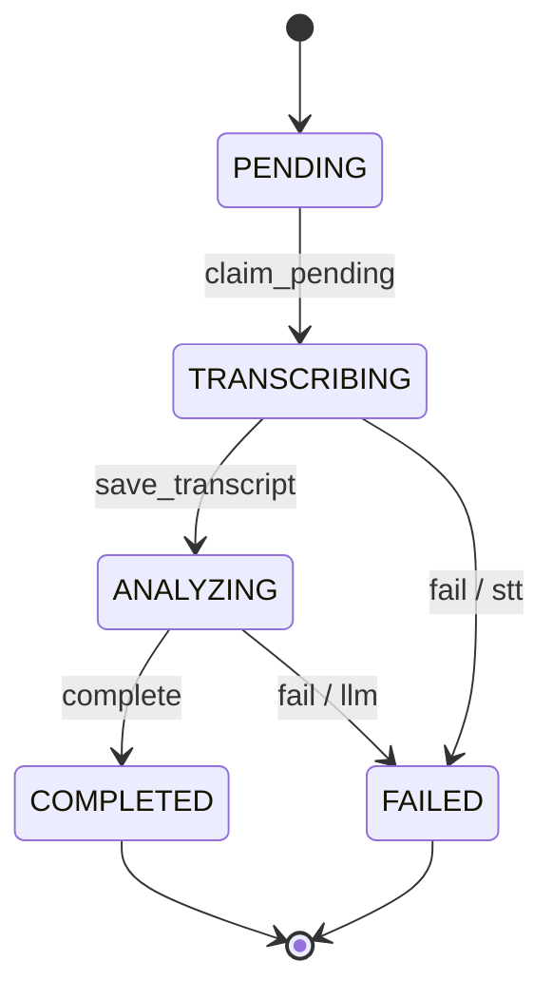

# Conversation Analyzer

MVP backend для записи и AI-анализа разговоров. Архитектура — модульный монолит FastAPI; STT-провайдеры и LLM Analyzer изолированы от HTTP и приложения.

Стек: Python 3.12+, uv, FastAPI, Uvicorn, pydantic-settings, OpenAI SDK, SQLAlchemy 2.x и SQLite; pytest, HTTPX и Ruff для разработки.

## Установка

В облачном окружении Debian 13/Bash Python и uv уже доступны. Используется одна `.venv`; активация не нужна.

```bash
uv sync --locked --dev
# Необязательно: локальные настройки (не перезаписывайте существующий .env)
cp -n .env.example .env
```

На другой машине нужны Python 3.12+ и uv. Если Python отсутствует: `uv python install 3.12`.
`uv.toml` хранит кэш в `.cache/uv`, доступном для записи в cloud sandbox.
Настройки `APP_NAME`, `APP_ENV`, `DEBUG`, `LOG_LEVEL` читаются из окружения и `.env`; окружение имеет приоритет. Настройки кэшируются до перезапуска процесса.

## Запуск

```bash
uv run uvicorn app.main:app --host 127.0.0.1 --port 8000 --reload
```

Проверка в другом терминале: `curl -fsS http://127.0.0.1:8000/health` → `{"status":"ok"}`.

## Проверки

```bash
uv run pytest
uv run ruff check .
uv run ruff format --check .
```

Форматирование: `uv run ruff format .`. Новые зависимости: `uv add <package>` или `uv add --dev <package>`.

## Структура и статус

```text
app/
  main.py          # create_app() и ASGI app
  api/health.py    # GET /health
  core/config.py  # настройки и get_settings()
  core/logging.py # стандартное логирование
  transcription/  # контракт, локальный и облачный STT, фабрика
  analysis/       # LLM Analyzer, модели, промпт и проверка цитат
  persistence/    # Engine, Session Factory, AnalysisJob и Repository
  storage/local.py # потоковое локальное хранение аудио
  application/create_job.py # создание задачи с компенсацией ошибок БД
scripts/transcribe.py # проверка STT из командной строки
scripts/analyze.py    # анализ готовой транскрипции
scripts/init_db.py    # явная инициализация SQLite
tests/             # изолированные тесты приложения и настроек
AGENTS.md          # рабочие инструкции для следующих агентов
```

Этап 1: окружение, application factory, настройки, логирование, healthcheck и тесты.
Этап 2: локальная и облачная транскрибация через единый асинхронный контракт.
Этап 3: независимый LLM-анализ готовой транскрипции.
Этап 4: SQLite, локальное хранение аудио и защищённый жизненный цикл задач. HTTP-загрузка, pipeline, фоновая обработка и frontend ещё не реализованы.


## Транскрибация

По умолчанию используется `STT_PROVIDER=local`: faster-whisper загружает `small` при первом вызове, на CPU с `int8` и четырьмя потоками; язык — русский. Настройки `WHISPER_MODEL`, `WHISPER_DEVICE`, `WHISPER_COMPUTE_TYPE`, `WHISPER_LANGUAGE`, `WHISPER_CPU_THREADS` описаны в `.env.example`. `WHISPER_MODEL` может содержать путь к локальной директории модели в формате CTranslate2. Один экземпляр провайдера повторно использует модель и выполняет одно распознавание за раз. На CPU загрузка и распознавание могут занять заметное время и оперативную память.

```bash
uv run python scripts/transcribe.py path/to/audio.wav
```

При первом использовании имени модели faster-whisper скачивает веса в системный кэш Hugging Face (обычно `~/.cache/huggingface/hub` в Linux или каталог кэша пользователя в Windows; расположение зависит от `HF_HOME` и `HF_HUB_CACHE`). В репозиторий веса не сохраняются. Для offline-работы заранее выполните локальную транскрибацию с нужной моделью при доступном интернете, либо заранее подготовьте директорию модели CTranslate2 и укажите её в `WHISPER_MODEL`. На целевой машине модель и все файлы должны быть доступны до отключения сети.

Для облачного режима задайте `STT_PROVIDER=cloud` и `OPENAI_API_KEY` в окружении или локальном `.env`. `OPENAI_STT_MODEL` выбирает модель (по умолчанию `gpt-4o-mini-transcribe`), `OPENAI_STT_TIMEOUT` — таймаут в секундах. Облачные запросы требуют сети и могут быть платными. Локальному режиму ключ не нужен.

В коде создайте провайдер через `create_transcriber(settings)` и повторно используйте его. У облачного провайдера после завершения работы вызовите `await provider.aclose()`. Оба провайдера возвращают строку; API загрузки и обработка аудио не входят в этот этап.

## Анализ готовой транскрипции

`app.analysis` принимает готовую строку и возвращает Pydantic `AnalysisResult`: `summary`, `strengths`, `mistakes`, `recommendations`. Каждый элемент `strengths` и `mistakes` содержит `description` и дословную `quote` либо `null`. Используются OpenAI Structured Outputs и модель `gpt-4o-mini` по умолчанию.

Задайте `OPENAI_API_KEY` в окружении или `.env` и запустите ручную проверку:

```bash
uv run python scripts/analyze.py transcript.txt
```

CLI читает UTF-8 файл и выводит JSON. `OPENAI_LLM_MODEL` задаёт модель, `OPENAI_LLM_TIMEOUT` — таймаут в секундах, `OPENAI_LLM_MAX_RETRIES` — число повторов (0–5). Ключ не нужен для локального STT или импорта FastAPI; при создании OpenAI Analyzer без ключа возникает понятная ошибка.

Системный промпт находится в `app/analysis/prompts/default.md`. Его можно заменить без изменения Python-кода; новый процесс загрузит новый текст. Транскрипция передаётся отдельно от системных инструкций. Grounding проверяет наличие цитат в исходном тексте с нормализацией регистра и пробелов, но не доказывает смысловую верность каждого вывода. Схема результата предварительная и потребует согласования с промптом заказчика. Автоматические тесты не вызывают LLM и не требуют сети.

## Хранение аудио и задач

Настройки (также в `.env.example`):

```dotenv
DATABASE_URL=sqlite:///./data/app.db
AUDIO_STORAGE_DIR=./data/audio
MAX_AUDIO_SIZE_MB=20
```

Относительные пути считаются от текущей рабочей директории. Используется синхронный SQLite через SQLAlchemy 2.x; другие СУБД, async-драйверы и URI/query-параметры не поддерживаются. Размер задаётся целым положительным числом MiB (1 MiB = 1024² байт). Каталог `data/` исключён из Git.

Инициализация выполняется явно, из корня проекта:

```bash
uv run python scripts/init_db.py
```

Команда создаёт отсутствующие каталоги и таблицы, повторный запуск сохраняет данные. Импорт FastAPI и persistence-модулей не открывает БД и не создаёт файлы. `create_all()` не обновляет существующую схему: автоматических миграций пока нет.

Таблица `analysis_jobs` содержит одну запись на аудио: UUID приложения в строковом формате, `source`, `status`, относительный `audio_path`, отдельный nullable `transcript`, nullable JSON `analysis`, `error_code`, `error_stage`, `created_at` и `updated_at`. JSON создаётся только из существующего `app.analysis.models.AnalysisResult` через `model_dump(mode="json")`; модель повторно валидируется перед записью. SQLite хранит даты без смещения в UTC; Python получает timezone-aware `datetime` с UTC. Наивные даты при записи отклоняются.



Все переходы используют `UPDATE ... WHERE id = ... AND status = ...` с проверкой числа строк. Повторный захват и запоздавшая ошибка после завершения отклоняются через `InvalidJobTransitionError`; отсутствующий UUID даёт `AnalysisJobNotFoundError`. Терминальные состояния не изменяются через Repository. STT-ошибка допустима только в `TRANSCRIBING`, LLM-ошибка — в `ANALYZING`. `error_stage` принимает `stt` или `llm`; `error_code` — заранее выбранный машинный код вида `STT_TIMEOUT` (латинские заглавные буквы, цифры, `_`, до 64 символов). Не передавайте текст исключения, ключи или ответы провайдеров в поля ошибок.

`AnalysisJobRepository` получает сессию от вызывающего кода, делает flush/условные обновления и никогда не вызывает commit. `session_factory.begin()` фиксирует успешную операцию, при исключении выполняет rollback и всегда закрывает сессию. ORM-объекты остаются внутри persistence/application-слоя; будущий API должен преобразовать их в собственные ответы, а провайдеры получают путь или строку.

Пример создания задачи из бинарного потока без зависимости от FastAPI:

```python
from app.application.create_job import create_job
from app.core.config import get_settings
from app.persistence.database import create_database_engine, create_session_factory
from app.persistence.repository import AnalysisJobRepository
from app.storage.local import LocalAudioStorage

settings = get_settings()
engine = create_database_engine(settings.database_url)
sessions = create_session_factory(engine)
storage = LocalAudioStorage(settings.audio_storage_dir, settings.max_audio_size_mb)
try:
    with open("recording.wav", "rb") as audio:
        job_id = create_job(
            audio,
            filename="recording.wav",
            source="upload",
            storage=storage,
            session_factory=sessions,
        )
    # Только подготовка операций для будущего обработчика, без вызовов STT/LLM.
    with sessions.begin() as session:
        AnalysisJobRepository(session).claim_pending(job_id)
    transcript = "Уже полученный результат STT"
    with sessions.begin() as session:
        AnalysisJobRepository(session).save_transcript(job_id, transcript)
    # Позже: отдельная транзакция complete(job_id, analysis_result),
    # либо fail(job_id, error_code="LLM_TIMEOUT", error_stage="llm").
finally:
    engine.dispose()
```

Захват нужно зафиксировать до работы STT. Транскрипт и `ANALYZING` сохраняются атомарно и фиксируются до вызова LLM; ошибка анализа не удаляет транскрипт. Анализ и `COMPLETED` также записываются одним обновлением. Держите каждую транзакцию короткой: сетевые STT/LLM-вызовы выполняются вне неё. Синхронные операции БД и файловой системы в будущем API следует вызывать из sync-handler или thread pool, не выполнять длительную работу в event loop. Не делитесь сессией между потоками/задачами.

`LocalAudioStorage.save(stream, filename=...)` читает поток порциями до 64 KiB и отклоняет пустой файл или превышение лимита. Разрешены WAV, MP3, WebM, M4A (регистр расширения не важен). Проверка расширения предварительная: содержимое не декодируется и формат не подтверждается; конвертации и установки FFmpeg нет. Имя пользователя используется только для проверки расширения; имена с компонентами пути отклоняются. Файл получает отдельное UUID-имя, `save()` возвращает только относительный ключ. `get_path(key)` возвращает путь внутри хранилища, `delete(key)` удаляет файл (повторное удаление безопасно). Некорректные ключи, traversal и символические ссылки отклоняются через `AudioStorageError`. Входной поток закрывает вызывающий код.

Файл сначала пишется во временный файл в том же каталоге, затем публикуется атомарным переименованием; при обычной ошибке неполный файл удаляется. Создание задачи сохраняет аудио, затем фиксирует `PENDING` в БД. Если flush или commit не удался, сервис удаляет сохранённый файл; если сама компенсация не удалась, сохраняет исходную ошибку и пишет обезличенное сообщение в лог. SQLite и файловая система не образуют общую транзакцию: аварийное завершение процесса или недоступность каталога могут оставить orphan-файлы, в том числе временные. Автоматической сверки/очистки и гарантий fsync при потере питания пока нет.

Все тесты запускаются приведёнными выше командами без API-ключей, сети, скачивания моделей и inference. Новые тесты используют `tmp_path`, настоящую временную SQLite, отдельные сессии для гонок и не обращаются к рабочему `data/`. Проверяются транзакции, все переходы, конкурентный захват и завершение, ошибки файловой системы и компенсация после ошибки БД. Автоматическое восстановление задач, оставшихся в обработке после сбоя процесса, retry и исполнение pipeline относятся к следующему этапу.
